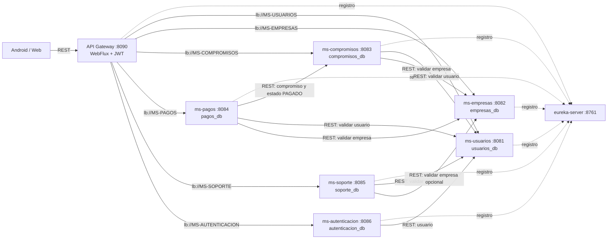

# PagoFlex - Arquitectura de microservicios

PagoFlex separa la gestión de usuarios, empresas, compromisos, pagos, soporte y autenticación en servicios Spring Boot independientes. Cada servicio conserva su base de datos y expone contratos REST. Eureka Server brinda descubrimiento por nombre de aplicación y el API Gateway centraliza el acceso HTTP externo.

## Servicios y puertos

| Servicio | Puerto | Base de datos | Responsabilidad |
|---|---:|---|---|
| `eureka-server` | 8761 | Ninguna | Registro y descubrimiento de instancias |
| `ms-usuarios` | 8081 | `usuarios_db` | Información y estado de usuarios |
| `ms-empresas` | 8082 | `empresas_db` | Información y estado de empresas |
| `ms-compromisos` | 8083 | `compromisos_db` | Compromisos y sus estados |
| `ms-pagos` | 8084 | `pagos_db` | Registro de pagos simulados |
| `ms-soporte` | 8085 | `soporte_db` | Solicitudes de soporte |
| `ms-autenticacion` | 8086 | `autenticacion_db` | Registro/login, BCrypt y emisión de JWT |
| `api-gateway` | 8090 | Ninguna | Entrada HTTP, seguridad JWT y enrutamiento |

Todos los servicios usan Java 21 y Spring Boot 3.5.4. Eureka Server y los seis clientes usan Spring Cloud 2025.0.0.

## Descubrimiento y comunicación REST

Los seis microservicios se registran en `http://localhost:8761/eureka/` con nombres de servicio únicos. Los consumidores usan esos nombres a través de Spring Cloud LoadBalancer, no direcciones de instancia fijas:

- `ms-autenticacion` consulta usuarios en `ms-usuarios`.
- `ms-compromisos` valida usuarios y empresas en `ms-usuarios` y `ms-empresas`.
- `ms-pagos` valida compromiso, usuario y empresa; al marcar un pago exitoso invoca el endpoint actual de pago de `ms-compromisos`.
- `ms-soporte` valida usuario y, si viene informado, empresa.

Las llamadas REST tienen timeout de conexión y respuesta configurables y los reintentos de LoadBalancer están deshabilitados. Los errores de dependencias no se convierten en éxito: una caída produce HTTP 503; un error 5xx remoto se comunica como 502; respuestas 400, 404 y 409 conservan su código.

La escritura en servicios diferentes no forma una transacción distribuida. Para confirmar un pago, `ms-pagos` solicita primero que `ms-compromisos` marque como pagado el compromiso y envía el ID estable del pago. El compromiso guarda ese ID y procesa la misma confirmación de forma idempotente. Solo después de recibir confirmación, `ms-pagos` cambia el pago de `PENDIENTE` a `EXITOSO`.

Si la llamada remota falla o vence por timeout, `ms-pagos` conserva el pago como `PENDIENTE` y responde con error; no registra un éxito local incompleto. La operación se recupera reintentando `PATCH /api/pagos/{id}/exitoso` para el mismo pago. Si el primer intento alcanzó `ms-compromisos` pero se perdió la respuesta, el ID de pago permite devolver la confirmación previa sin cambiar el compromiso por segunda vez. No se crea otro pago ni se aplican cargos adicionales. La reconciliación es manual mediante ese reintento; no hay un proceso automático en segundo plano.

## JWT y autorización directa

`ms-autenticacion` mantiene registro, login, BCrypt y JWT HS256. Los demás servicios validan los JWT directamente con la misma clave compartida, sin depender de un Gateway. El claim `rol` conserva `CLIENTE`, `EMPRESA` o `ADMIN`; para usuarios EMPRESA se incluye `empresaId` como claim adicional. `ms-compromisos`, `ms-pagos` y `ms-soporte` comprueban en el propio servicio que las lecturas pertenecen al `usuarioId` o `empresaId` del token validado. Los IDs del cuerpo no autorizan la operación ni permiten cambiar el propietario de un compromiso. `ADMIN` y las llamadas internas autenticadas con `X-Internal-Token` tienen acceso privilegiado; los listados globales y las operaciones administrativas siguen restringidos.

Las llamadas internas usan el encabezado `X-Internal-Token`, configurado por entorno y compartido entre los servicios. El token interno no sustituye al JWT de usuario y debe mantenerse secreto.

## API Gateway

El Gateway reactivo es el punto de entrada externo en `http://localhost:8090`. Define rutas manuales mediante nombres Eureka y conserva los prefijos REST existentes:

| Ruta | Servicio |
|---|---|
| `/api/usuarios/**` | `MS-USUARIOS` |
| `/api/empresas/**` | `MS-EMPRESAS` |
| `/api/compromisos/**` | `MS-COMPROMISOS` |
| `/api/pagos/**` | `MS-PAGOS` |
| `/api/soporte/**` | `MS-SOPORTE` |
| `/api/auth/**` | `MS-AUTENTICACION` |

El Gateway valida JWT HS256 con `JWT_SECRET`, verifica los claims `usuarioId` y `rol` (y `empresaId` para el rol `EMPRESA`) y aplica permisos por operación. El registro/login de autenticación y la creación pública de usuario siguen disponibles sin JWT, según los contratos actuales. Los microservicios conservan su propia seguridad y validan de nuevo las solicitudes. El Gateway elimina el encabezado externo `X-Internal-Token` antes de reenviar una petición para evitar que un cliente suplante llamadas internas.

El CORS reactivo permite orígenes exactos definidos en `CORS_ALLOWED_ORIGINS`, métodos GET/POST/PUT/PATCH/DELETE/OPTIONS y encabezados Authorization/Content-Type/Accept; no permite credenciales ni el comodín `*`. El endpoint de administración Gateway de Actuator requiere rol ADMIN.

## Variables de entorno

No se incluyen secretos ni credenciales reales. Configura las variables en el entorno de cada proceso:

| Variable | Uso |
|---|---|
| `JWT_SECRET` | Clave HS256 de al menos 32 bytes; mismo valor en autenticación y servicios que validan JWT |
| `INTERNAL_SERVICE_TOKEN` | Secreto compartido de al menos 32 bytes para llamadas REST internas; debe coincidir entre consumidores y servicios receptores |
| `DB_URL` | URL JDBC MySQL del servicio que se inicia; por defecto se aplica la base correspondiente y `localhost:3306` |
| `DB_USERNAME`, `DB_PASSWORD` | Credenciales MySQL |
| `EUREKA_DEFAULT_ZONE` | Por defecto `http://localhost:8761/eureka/` |
| `EUREKA_URL` | URL Eureka del API Gateway; por defecto `http://localhost:8761/eureka/` |
| `CORS_ALLOWED_ORIGINS` | Orígenes CORS separados por coma; por defecto `http://localhost:3000,http://localhost:4200` |
| `EUREKA_CLIENT_ENABLED` | Habilita cliente Eureka; `true` por defecto |
| `USUARIOS_SERVICE_URL` | Override opcional, por defecto `http://ms-usuarios` |
| `EMPRESAS_SERVICE_URL` | Override opcional, por defecto `http://ms-empresas` |
| `COMPROMISOS_SERVICE_URL` | Override opcional, por defecto `http://ms-compromisos` |
| `SERVICE_CONNECT_TIMEOUT_MS` | Timeout de conexión REST; por defecto 2000 ms |
| `SERVICE_READ_TIMEOUT_MS` | Timeout de respuesta REST; por defecto 3000 ms |
| `JWT_EXPIRATION_MS` | Duración de JWT; por defecto 3600000 ms |

En contenedores, configura Eureka con su DNS/nombre accesible desde la red de contenedores y usa ese valor en `EUREKA_DEFAULT_ZONE`. Los nombres de servicio usados por LoadBalancer deben coincidir con `spring.application.name`; las variables `*_SERVICE_URL` pueden apuntar al nombre DNS del servicio si la plataforma de contenedores no usa el registro Eureka.

## Orden recomendado de inicio

Inicia cada comando desde la carpeta indicada, en terminales separadas:

1. `eureka-server`: `.\mvnw.cmd spring-boot:run`
2. `ms-usuarios`: `.\mvnw.cmd spring-boot:run`
3. `ms-empresas`: `.\mvnw.cmd spring-boot:run`
4. `ms-compromisos`: `.\mvnw.cmd spring-boot:run`
5. `ms-pagos`: `.\mvnw.cmd spring-boot:run`
6. `ms-soporte`: `.\mvnw.cmd spring-boot:run`
7. `ms-autenticacion\ms-autenticacion`: `.\mvnw.cmd spring-boot:run`
8. `api-gateway`: `.\mvnw.cmd spring-boot:run`

Define `JWT_SECRET`, `INTERNAL_SERVICE_TOKEN` y variables MySQL antes de iniciar. `JWT_SECRET` debe tener al menos 32 bytes y el mismo valor en `ms-autenticacion`, los microservicios protegidos y el Gateway. No guardes los valores reales en el repositorio. El panel Eureka está en http://localhost:8761/; las instancias aparecen bajo **Instances currently registered with Eureka**. En local, consulta además `/eureka/apps` para ver el registro.

Si `INTERNAL_SERVICE_TOKEN` está vacío, el proceso puede iniciarse para pruebas aisladas, pero las llamadas internas no obtienen el rol `SERVICE` y serán rechazadas. En ejecución integrada, configura un token aleatorio de al menos 32 bytes con el mismo valor en cada consumidor y receptor.

Comprueba el Gateway en `http://localhost:8090/actuator/health`. Para ver rutas disponibles en Actuator se requiere un JWT con rol ADMIN en `/actuator/gateway/routes`.

## Endpoints REST principales

Los endpoints existentes se mantienen:

- Usuarios: `/api/usuarios`, `/api/usuarios/{id}`, `/api/usuarios/correo/{correo}` y operaciones administrativas de rol/desactivación.
- Empresas: `/api/empresas`, `/api/empresas/{id}`, `/api/empresas/rut/{rut}`, activación y desactivación.
- Compromisos: `/api/compromisos`, `/api/compromisos/{id}`, filtros por usuario/empresa/estado, `PATCH /api/compromisos/{id}/pagar` y `/cancelar`.
- Pagos: `/api/pagos`, búsquedas por usuario/empresa/compromiso/estado y transiciones `/exitoso`, `/rechazar`, `/anular`.
- Soporte: `/api/soporte` y filtros por ID, usuario, empresa, estado, categoría y prioridad; cambios con rutas `/estado`, `/responder` y `/cerrar`.
- Autenticación: `POST /api/auth/registro`, `POST /api/auth/login`, `GET /api/auth/validar`, `GET /api/auth/me`, `PATCH /api/auth/desactivar/{usuarioId}`.

Cada API Springdoc conserva su documentación local en `/swagger-ui/index.html` y `/v3/api-docs`.

## Pruebas

Las pruebas unitarias y de integración de cada microservicio usan H2 o mocks y no requieren levantar MySQL ni toda la plataforma. Desde cada proyecto ejecuta:

```powershell
.\mvnw.cmd clean test
```

Las pruebas con servicios simulados no sustituyen una prueba de despliegue con Eureka y los seis procesos levantados.

## Diagrama


