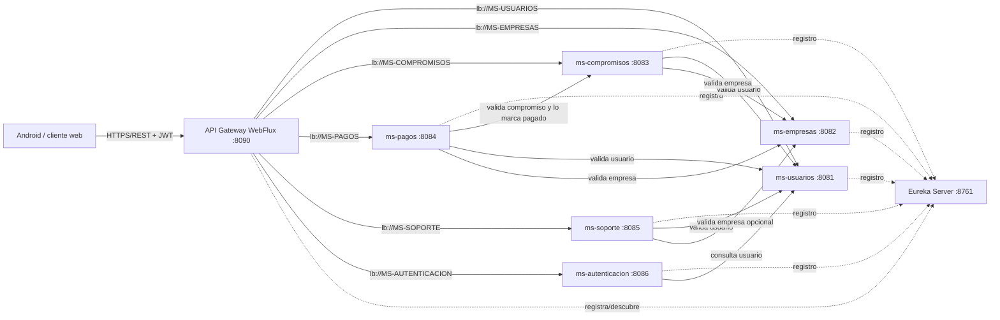

# PagoFlex API Gateway

API Gateway es el punto de entrada HTTP de PagoFlex. Enruta peticiones a los microservicios mediante Eureka y valida JWT antes de permitir el acceso a las rutas protegidas. Está implementado con Spring WebFlux; no contiene persistencia ni usa MySQL.

## Tecnologías

- Java 21
- Spring Boot 3.5.4
- Spring Cloud 2025.0.0
- Spring Cloud Gateway WebFlux
- Eureka Discovery Client y Spring Cloud LoadBalancer
- Spring Security Resource Server con JWT HS256
- Spring Boot Actuator

## Puerto y rutas

El Gateway escucha en el puerto `8090`. Las rutas conservan los prefijos esperados por los controladores existentes:

| Ruta | Destino Eureka |
|---|---|
| `/api/usuarios/**` | `lb://MS-USUARIOS` |
| `/api/empresas/**` | `lb://MS-EMPRESAS` |
| `/api/compromisos/**` | `lb://MS-COMPROMISOS` |
| `/api/pagos/**` | `lb://MS-PAGOS` |
| `/api/soporte/**` | `lb://MS-SOPORTE` |
| `/api/auth/**` | `lb://MS-AUTENTICACION` |

El localizador automático de rutas está deshabilitado. El Gateway elimina el encabezado `X-Internal-Token` que pudiera enviar un cliente externo; los servicios internos mantienen su propia validación JWT/token.

## Autenticación y permisos

Los JWT se verifican con HS256 y la misma clave `JWT_SECRET` que usa `ms-autenticacion`. El Gateway exige claims válidos `usuarioId` y `rol`, acepta los roles `CLIENTE`, `EMPRESA` y `ADMIN`, y exige `empresaId` para un token EMPRESA. Los tokens mal formados, vencidos o con claims/roles inválidos reciben HTTP 401.

Públicos:

- `POST /api/auth/registro`
- `POST /api/auth/login`
- `POST /api/usuarios` (creación de usuario, permitida públicamente por el servicio actual)
- `GET /actuator/health` y `GET /actuator/info`

Los accesos de lectura/escritura a empresas y las operaciones administrativas de usuarios, pagos, compromisos, soporte y autenticación requieren ADMIN. CLIENTE y EMPRESA pueden crear compromisos, pagos y tickets; las comprobaciones de propiedad también se mantienen en cada microservicio. Consultas de detalle de compromisos, pagos y tickets requieren JWT. El endpoint de Actuator Gateway también requiere ADMIN.

## CORS y errores

`CORS_ALLOWED_ORIGINS` es una lista separada por comas de orígenes permitidos exactos. El valor local inicial es `http://localhost:3000,http://localhost:4200`. Se permiten GET, POST, PUT, PATCH, DELETE y OPTIONS, y los encabezados Authorization, Content-Type y Accept. No se permiten credenciales ni `*`.

Los errores del Gateway se devuelven como JSON con timestamp, status, error, message y path. Una instancia no disponible se informa como 502; timeouts como 504; las respuestas HTTP de error de un servicio se normalizan y no se convierten en éxito.

## Variables de entorno

| Variable | Descripción |
|---|---|
| `JWT_SECRET` | Obligatoria; secreto HS256 de al menos 32 bytes. No se guarda en el repositorio. |
| `EUREKA_URL` | URL base de Eureka; valor local por defecto `http://localhost:8761/eureka/`. |
| `CORS_ALLOWED_ORIGINS` | Orígenes CORS exactos separados por coma. |

## Inicio local

Primero inicia Eureka Server en otra terminal. Luego, desde esta carpeta, en PowerShell:

```powershell
$env:JWT_SECRET = "<secreto-local-de-al-menos-32-bytes>"
$env:EUREKA_URL = "http://localhost:8761/eureka/"
$env:CORS_ALLOWED_ORIGINS = "http://localhost:3000,http://localhost:4200"
.\mvnw.cmd spring-boot:run
```

El Gateway escucha en `http://localhost:8090`. Eureka muestra su registro en `http://localhost:8761/`.

## Pruebas con Postman

1. `POST http://localhost:8090/api/auth/login` con el cuerpo JSON definido por el endpoint de autenticación; no requiere token y devuelve el JWT.
2. Usa `Authorization: Bearer <token>` para las rutas protegidas.
3. Prueba, por ejemplo, `GET http://localhost:8090/api/compromisos/1` o `POST http://localhost:8090/api/soporte`.
4. Comprueba que una operación administrativa como `GET /api/usuarios` responda 403 con un token CLIENTE y sea autorizada con ADMIN.

## Actuator

- Salud: `GET http://localhost:8090/actuator/health`
- Información: `GET http://localhost:8090/actuator/info`
- Rutas Gateway: `GET http://localhost:8090/actuator/gateway/routes` (JWT ADMIN)

Solo se exponen `health`, `info` y `gateway`; las rutas de administración no son públicas.

## Arquitectura



## Verificación

Ejecuta `.\mvnw.cmd clean test` desde esta carpeta. Las pruebas usan configuración de test y no requieren levantar los seis microservicios. Una prueba simultánea de registro/enrutamiento contra Eureka real y las bases MySQL no se considera ejecutada por las pruebas automatizadas.
